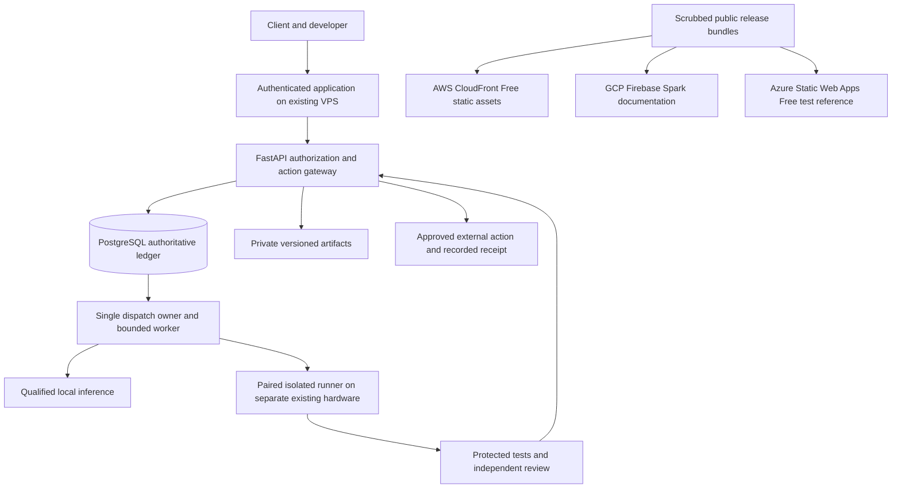

# SynqHarbor AI Production Build Plan

Planning date: 2026-10-16. Status: all ten phases are planned; none is implemented or deployed.

Build a self-hosted collaboration platform for small software and automation agencies. The first complete workflow is a client change request, explicit acceptance criteria, an isolated Builder, protected tests, an independent Reviewer, a artifact view, separate client and developer approvals, and a recorded release receipt. Later business and content workflows reuse this foundation.

The cost policy is **USD $0 in new service charges**. Reuse the existing server and domain; these already have ownership costs and are not literally free infrastructure. Use free software and qualified no-cost cloud plans. Development labor, electricity, existing connectivity, and existing subscriptions are outside the incremental service-cost target. No new paid subscriptions, paid model APIs, cloud VMs, managed databases, trial-credit-dependent production, or paid fallback routes are required.

This is a build and release specification. It does not authorize provisioning, signup, publication, a server change, or spending during the planning task. Provider eligibility, live capacity, DNS, and credentials must be checked during execution. A blocked cloud deployment remains blocked; a local emulator cannot be counted as a real three-cloud deployment.

## Product and architecture decisions

| Area | Decision and reason |
|---|---|
| Product scope | Client delivery first. Two human personas, two isolated agent roles, two workspaces for isolation tests, one test repository. Avoid building a Slack replacement. |
| Frontend | Next.js, React, TypeScript. Prefer a static client shell with API-driven authenticated data initially; cloud surfaces are separate static builds. Add server rendering only for an actual requirement. |
| Backend | FastAPI, Pydantic, SQLAlchemy, Alembic, and a modular monolith. Keep auth, tasks, approvals, artifacts, connectors, and operations as clear modules. |
| Database | PostgreSQL is authoritative for memberships, tasks, attempts, event sequences, approvals, action intents/receipts, budgets, and schedules. Separate migration and restricted application roles. |
| Execution | One PostgreSQL-backed dispatcher owns claims, leases, fencing, retries, and state transitions. A dedicated worker invokes adapters. No Celery/Temporal/custom-scheduler combination. |
| AI | Deterministic test in tests; qualified local CPU inference for real runs. llama.cpp is an available MIT-licensed runtime, but model weights, their license, quality, memory, and performance need separate qualification. [Runtime source](https://github.com/ggml-org/llama.cpp) |
| Code runner | Outbound paired runner on separately isolated existing Linux/WSL hardware. The shared production server does not execute arbitrary agent-generated code. |
| Artifacts | Private filesystem-backed blob storage behind a storage interface initially; opaque object keys, authenticated API downloads, version hashes, quotas, quarantine, and backup. S3 compatibility is optional, not a reason to create billed storage. |
| Retrieval | PostgreSQL full-text search first; pgvector and a qualified local embedding model when useful. Hybrid search is supported without another database. [pgvector](https://github.com/pgvector/pgvector) |
| Live updates | SSE from persisted event sequences; reconnect, access recheck, backpressure, and polling fallback. Redis is optional and never authoritative. |
| Deployment | Docker Compose on the existing server, project-specific private networking, existing Caddy, and a retained previous release. Build on the development machine where practical. |
| Observability | Structured redacted logs and OpenTelemetry instrumentation; bounded local collection, health checks, and operator views. No hosted observability subscription required. |
| Tests and CI | Pytest, frontend component tests, Playwright, integration/security/evaluation suites, Gitleaks, Bandit, Semgrep, dependency/image scans, and build checks. Local execution works without hosted CI. |
| Integrations | GitHub test repository and an upload/manual-import business connector first. MCP is a later capability adapter. A2A and n8n are not required for v1. |

Keep the repository in this prepared folder. The source blueprint's suggested move into another WSL folder is not necessary. Benchmark filesystem performance in Phase 1; consider any later move separately, preserving Git, private memory, credentials, and references.

For the static Next.js shell, authentication and all dynamic operations belong to FastAPI on the core origin. Use fixed shell routes with client-loaded identifiers; do not assume unknown dynamic routes, Server Actions, or request-dependent Next.js handlers work in a static export. Headers and API routing are configured at the origin gateway. [Next.js static export](https://nextjs.org/docs/app/guides/static-exports)

### Runtime and trust boundaries

Public cloud builds contain no tenant content, session credentials, private traces, infrastructure recovery records, or authenticated API. The core continues operating if a static cloud surface fails. This is a hybrid deployment using three clouds, **not active-active core hosting or database disaster recovery**.

## Free service selection and cost controls

### Required provider roles

| Destination | Useful role | Official free-plan boundary | Plan-specific controls |
|---|---|---|---|
| Existing server | Authenticated core, PostgreSQL, private blobs, dispatch/worker, bounded local inference | Reuse the already owned server; additional free capacity has not been measured | Inventory before allocation; no provider upgrade or backup add-on; enforce memory/CPU/disk limits and preserve unrelated applications |
| AWS | Deliver public brand assets, screenshots, and scrubbed workflow-catalog assets through CloudFront | Select **CloudFront Free flat-rate**, which is distinct from its pay-as-you-go free allowance. Free flat-rate has a $0 monthly price and no plan overage charges. [AWS FAQ](https://aws.amazon.com/cloudfront/faqs/) | Use the existing server's isolated static origin and the provider hostname initially. No S3, Route 53 migration, Lambda, or separate log-storage resource. Restrict origin content to immutable public files. |
| GCP | Publish public onboarding, operator documentation, architecture, and scrubbed API examples | Firebase Hosting on **Spark**; no payment information required for that plan. Firebase projects are Google Cloud projects. Linking Cloud Billing changes the project to Blaze. [Firebase plans](https://firebase.google.com/docs/projects/billing/firebase-pricing-plans) | Dedicated unbilled Spark project; no Cloud Run, Functions, App Hosting, Cloud Storage, or Blaze. No real customer data. Use the provider hostname. |
| Azure | Host the public interactive product workflows and schema-driven test dashboard | **Static Web Apps Free**, static assets only. Free has no SLA; bandwidth overage is unavailable. [Plans](https://learn.microsoft.com/en-us/azure/static-web-apps/plans), [quotas](https://learn.microsoft.com/en-us/azure/static-web-apps/quotas) | Explicit Free SKU; no separate Functions, App Service, Application Insights, or database. test fixtures only; no core session cookies or real execution buttons. |
| Development machine | Builds, local CI, isolated runner, encrypted off-server backup destination | Reuse existing hardware and storage; no new cloud charge | Verify available disk, isolation, online schedule, encryption, and restore access. An offline PC is not an always-available backup service. |

For AWS, the published Free flat-rate allowance is 1 million requests and 100 GB transfer monthly; account history can affect eligibility. It does not make arbitrary origin resources free. Use a static origin only after checking the existing server's transfer allowance and expected traffic. [CloudFront plans](https://docs.aws.amazon.com/AmazonCloudFront/latest/DeveloperGuide/flat-rate-pricing-plan.html)

Firebase Hosting currently lists 10 GB storage and 10 GB/month transfer at no cost. Without Blaze, exhausted storage blocks new deployments and exhausted transfer can disable sites after a grace period. Keep archives locally and serve fallback documentation from the existing server rather than upgrade. [Hosting quotas](https://firebase.google.com/docs/hosting/usage-quotas-pricing)

Azure Free currently lists 100 GB/month bandwidth, 250 MB per environment, and 500 MB total storage. Documentation differs on some custom-domain counts, so use the provider domain and verify the actual SKU limits before deployment. The test reference must tolerate service limits; the authenticated client workflow does not depend on this site. [Azure quotas](https://learn.microsoft.com/en-us/azure/static-web-apps/quotas)

### Fail-closed spending policy

1. Inventory the actual account and all existing consumption before deployment. Use AWS Resource Explorer, GCP Cloud Asset Inventory, and Azure Resource Graph; cross-check billing/usage, project plan state, and service-native inventories. If a required inventory is unavailable, record the gap rather than guessing resources from memory.
2. Do not create an account requiring payment details, attach billing, upgrade a plan, or accept paid terms under the name of free setup. If such a step is necessary, stop before it under global Rule 5. This plan does not supply that approval.
3. AWS must report the actual Free flat-rate association for the intended distribution. Do not substitute pay-as-you-go. Do not cancel the plan while leaving resources active: AWS documents that cancellation can return them to pay-as-you-go. Disable/remove the distribution and inspect dependent resources under a reviewed teardown procedure. [AWS FAQ](https://aws.amazon.com/cloudfront/faqs/)
4. Firebase must remain Spark with no billing link. Azure deployment must specify Free and policy must reject Standard. Never automatically upgrade either provider or compensate for throttling with a paid backend.
5. Record provider allowances separately from conservative internal operating caps. Proposed caps: AWS assets 10 GB/month, Firebase documentation 1 GB/month and 100 MB retained release storage, Azure reference 5 GB/month and 100 MB per environment. These are configurable project limits, not provider guarantees or claimed measurements.
6. Monitor the whole billing scope, including unrelated projects where quotas are shared. Disable optional publishing when cost/plan evidence is stale or eligibility changes. Quota alerts are advisory; platform-enforced free-plan behavior is the main billing boundary.
7. Budget alerts do not by themselves impose a hard cap on metered GCP services. For that reason, Cloud Run and paid-account free allowances are excluded from the baseline. [GCP budgets](https://cloud.google.com/billing/docs/how-to/budgets)
8. Keep model API routes disabled. There is no OpenAI/Anthropic/Bedrock/Vertex/Azure AI/OpenRouter paid fallback, no credit top-up, no higher key cap, and no automatic subscription-credit purchase. Rate limits cause waiting or an explicit blocked state.
9. Hosted CI is optional. Before using it, verify free usage, artifact/cache retention, and a supported stop-usage budget. If enforcement is unavailable, run the same checks locally. No paid AI review action. [GitHub budget controls](https://docs.github.com/en/billing/how-tos/set-up-budgets)
10. Store a dated private cost-eligibility record with the account owner, SKU/plan, billing scope, remaining allowance, expiry if any, attached services, and disable/cleanup procedure. Credentials remain exclusively in the ignored recovery file and approved stores.

If a cloud cannot meet these conditions, publish its static bundle on the existing server and mark that provider milestone **blocked**, not completed. The full three-cloud milestone requires actual AWS, GCP, and Azure deployments with retained evidence. No trial credits are needed by the design.

## Parallel delivery and common release gates

Every phase has five concurrent workstreams: frontend, backend/data, agents/integrations, infrastructure/deployment, and quality/security. Parallel means independently scoped tasks built against an agreed interface; it does not mean deploying unfinished dependencies.

At phase start, define acceptance criteria and freeze the initial OpenAPI/schema/event contract. Frontend works against contract fixtures while backend implements the same contract; infrastructure builds the release pipeline while quality writes independent acceptance scenarios. Use separate branches/worktrees per feature where practical, one migration owner, and one release owner. Avoid concurrent edits to the same files and any concurrent shared-host/DNS allocation. Integrate small vertical slices daily or at each meaningful contract checkpoint.

Each phase ends in a versioned deployable increment, r01 through r10. These are planned release identifiers, not existing releases. Deploy to local Compose, then the isolated VPS staging application. Public cloud sites receive approved public changes relevant to that phase. Each phase's deployment is gated on its own tests; no all-backend-first or final-phase-only deployment strategy.

### Gates applied to every phase

- **G1 Specification:** written acceptance criteria, threat changes, data ownership, expected cost, and rollback before implementation.
- **G2 Tests:** relevant unit/component/integration/security/evaluation tests; regressions for any defect. Real automated suites remain tracked under tests/. Personal scripts remain in ignored manual-tests/ and are preserved.
- **G3 Static checks:** TypeScript check; backend type check; frontend/backend lint; configuration validation; formatting and migration checks appropriate to the touched files.
- **G4 Security and supply chain:** edit hooks and pre-commit active; Gitleaks, Bandit, Semgrep, dependency/image scanning, software bill of materials, and licenses. Verify new dependencies on their real registries, pin versions/digests, and document any reviewed finding. Release-blocking findings cannot be suppressed merely to pass.
- **G5 Build:** frontend and service builds, protected test harness build, Compose validation, and reproducible release manifest. CI uses test providers and never needs paid credentials.
- **G6 Behavior:** exercise each criterion through actual HTTP/CLI/UI flows in the named environment; label test, local-model, cloud, and human evidence distinctly.
- **G7 Independent review:** a fresh session/reviewer that did not write the change reviews criteria and exact diff. Product Builder/Reviewer sessions do not replace review of SynqHarbor's own code.
- **G8 Deployment:** drift inspection, local-first changes, migration/backup readiness, health and authorization smoke tests, rollback rehearsal, and local/live file hashes plus running image-digest evidence.
- **G9 Record:** exact commands, test counts, skips/failures, review verdict, deployed version, measured limits, unresolved risks, and cost evidence in private project records. Update the dossier first; public release notes are scrubbed derivatives. Escaped bugs go into DEFECT-LOG.md.

A missing gate is reported as missing. A green landing page or an agent's success message never substitutes for authenticated workflow evidence.

## Phase 1 Foundation and deployment skeleton

**Goal:** establish the product contract, threat model, no-spend architecture, and first working deployment skeleton. Depends on the prepared folder and supplied blueprint.

| Parallel workstream | Work delivered together |
|---|---|
| Frontend | Accessible application shell, Work/Inspect layouts, sign-in placeholder, task/artifact test screens, mobile approval interface, loading/empty/error states; no fake operational claims |
| Backend/data | FastAPI skeleton, typed configuration, health/readiness/version endpoints, migration baseline, principal/workspace/task/event schema contracts, structured error envelope |
| Agents/integrations | test adapter contract, agent/runtime/provider/runner separation, local inference qualification checklist, supported capability matrix, documented external-action boundary |
| Infrastructure/deployment | Local Compose; release/hash manifests; resource budget; server/DNS/listener/network inventory; conditional port/hostname reservation; Azure Free static-reference deployment definition |
| Quality/security | Threat model covering tenant leaks, prompt injection, SSRF, uploads, malicious code, forged approvals, insider/runner compromise, spending, and credential handling; CI/security setup and baseline smoke tests |

**Deploy r01:** deploy an inert maintenance/application shell and healthy API to isolated VPS staging using existing Caddy; publish the clearly labeled test UI on Azure Free after eligibility checks. Backend workspace features stay unavailable until authentication exists. No real customer inputs or secrets reach a public shell.

**Rollback:** redeploy the prior maintenance image; restore only this project's previous site configuration; preserve shared Caddy and unrelated applications. Archive the release off-server.

**Exit gates:** G1–G9 for this slice; configuration contains no source-embedded environment defaults; only intended web ingress is exposed; release hashes match; Azure is demonstrably Free; local/startup smoke and rollback succeed. Capture actual server headroom and determine whether inference belongs on the VPS or existing local hardware. Test references: COST-01, OPS-03, CFG-01, SEC-01, SUPPLY-01.

## Phase 2 Identity tenancy and secure workspace foundation

**Goal:** make two real human accounts operate in two isolated workspaces. Depends on Phase 1 contracts and capacity approval.

| Parallel workstream | Work delivered together |
|---|---|
| Frontend | Sign-in/sign-out, administrator-issued invitations, role/member management, session list, recovery screens, accessible workspace switching, visible unauthorized states |
| Backend/data | Vetted authentication libraries, Argon2id passwords, secure server-side sessions, CSRF controls, TOTP for privileged users, hashed recovery codes, session revocation, scoped memberships, restricted DB role and RLS |
| Agents/integrations | Nonhuman principals and explicit capability grants; draft-only registry; no agent can inherit administrator authority merely from its role name |
| Infrastructure/deployment | Secure/SameSite/HttpOnly cookies, trusted proxy/host configuration, per-route limits, separate migration identity, first application-consistent encrypted off-server backup and isolated restore |
| Quality/security | Cross-workspace API/DB tests, brute-force/session fixation/CSRF tests, recovery and invitation replay tests, tenant-switch tests, baseline keyboard/screen-reader checks |

**Deploy r02:** release the authenticated core to VPS staging with test users. Create AWS CloudFront Free flat-rate delivery for a dedicated public static asset origin after plan checks. Use default provider hostname initially; do not put authenticated pages, API responses, or private artifacts behind its cache. No S3 or Route 53 resource is needed.

**Rollback:** return to r01 maintenance for the core if auth fails; retain the database and encrypted backup; use additive schema migrations so reverting the image does not corrupt accounts. Disable the asset distribution through the reviewed procedure if its plan is wrong.

**Exit gates:** two users in different workspaces cannot access each other's records; privileged recovery invalidates previous access as specified; invite/recovery tokens cannot replay; database access fails closed without tenant scope; restore succeeds; AWS distribution readback proves Free flat-rate. Tests: AUTH-01, ID-01–ID-03, COST-02, CACHE-01, OPS-01.

No email provider is required: an administrator can securely transfer a one-time invitation link out of band. Automated email remains disabled until an already authorized no-cost route is qualified; never put recovery links in public logs.

## Phase 3 Collaboration tasks and durable test execution

**Goal:** conversations create explicit, recoverable work rather than hidden chat instructions. Depends on Phase 2 authorization.

| Parallel workstream | Work delivered together |
|---|---|
| Frontend | Rooms/threads, mentions, scoped human direct conversations, task creation with acceptance criteria, ownership, status board, Work/Inspect views, live timeline and reconnect UI |
| Backend/data | Persisted messages/tasks/attempts/events, transactional claim and outbox, leases/fencing/state versions, bounded retries, cancellation, deduplication keys, SSE authorization and cursor replay |
| Agents/integrations | Deterministic Builder/Reviewer routing through test runs; explicit assignment only; structured handoff packet; step/time/queue limits; no all-room-message agent fan-out |
| Infrastructure/deployment | Separate worker service, heartbeat/readiness probes, SSE proxy settings/timeouts, database indexing, small restart/kill rehearsal; GCP Firebase Spark documentation deployment definition |
| Quality/security | Reconnect ordering, duplicate delivery, cursor gaps, stale-worker rejection, race/cancel/retry tests, room/DM access and live revocation tests; contract compatibility checks |

**Deploy r03:** deploy the durable test workflow on VPS staging and Firebase Hosting Spark public documentation. Refresh Azure reference fixtures and AWS public assets where changed. At this point all three cloud surfaces must have genuine deployment/plan evidence, otherwise the three-cloud milestone is explicitly blocked.

**Rollback:** pause new dispatch, drain safe work, revert compatible web/API/worker images, and retain event/outbox records. Do not replay external writes during recovery; all execution is still test-only.

**Exit gates:** two humans collaborate on a test task; browser disconnect and worker replacement retain the same task history; stale workers cannot commit; cancelled jobs do not resume silently; unauthorized subscriptions and DM reads fail. Tests: AUTH-03, RUN-01–RUN-03, RUN-06, RUN-07, EVENT-01, COST-03, CLOUD-01.

## Phase 4 Artifacts protected evidence and exact approvals

**Goal:** make reviews and release authority bind to immutable evidence. Depends on durable tasks and scoped memberships.

| Parallel workstream | Work delivered together |
|---|---|
| Frontend | Versioned artifact panel, diff/source/evidence views, independent client-content and developer-release approval controls, stale/expired/rejected states, keyboard-accessible mobile review |
| Backend/data | Private blob interface, streaming bounded downloads, atomic upload/quarantine, content digests, immutable artifact versions, action-intent schema, canonical argument hashing, approver policy/expiry, fake receipts |
| Agents/integrations | Builder outputs structured artifacts; Reviewer sees a pinned version; safe rendering of model output; publication permission checked independently of source-read permission |
| Infrastructure/deployment | Private non-executable data volumes, disk quotas, no direct object URL bypass, CSP/security headers at origin, backup includes blobs and metadata consistently |
| Quality/security | Changed-content/target/environment/arguments approval invalidation, forged-chat approval tests, concurrent decision races, path traversal/symlink/MIME/XSS/upload-bomb fixtures |

**Deploy r04:** deploy the complete test request → artifact → review → two approvals → fake receipt flow. Publish only approved test example artifacts to the separate cloud reference surfaces; a tenant artifact never becomes public by default.

**Rollback:** stop action execution, revert images with compatible schema, preserve signed/hash-bound approval history and blobs, and restore access to the last verified version. Recompute authority server-side after any rollback.

**Exit gates:** changing any approved action field rejects the old approval; client approval alone cannot release; private sources cannot leak into a room; artifact downloads enforce current grants; malicious uploads remain quarantined/rejected. Tests: APPROVAL-01, APPROVAL-02, AUTH-04, FILE-01, FILE-02, APPROVAL-03, AUDIT-01.

## Phase 5 Local AI and isolated Builder Reviewer execution

**Goal:** replace test execution with one qualified local route on test coding tasks. Depends on Phase 4 authority and protected evidence.

| Parallel workstream | Work delivered together |
|---|---|
| Frontend | Agent/runtime registry, capability/permission display, runner pairing and heartbeat, queued/blocked/cancelled UI, local inference usage/latency; provider quota displays “Unavailable” unless actually supplied |
| Backend/data | Runner enrollment/revocation and short-lived job grants, execution budget reservations across attempts, authenticated signed result envelopes, model/provider configuration, adapter cancellation/checkpoint boundaries |
| Agents/integrations | Benchmark a commercially usable local model on held-out narrow patch tasks; separate Builder and Reviewer sessions; structured output validation and bounded tool calls; no paid provider fallback |
| Infrastructure/deployment | Qualified runner on separate existing hardware, disposable workspace, protected read-only acceptance harness, filesystem/network/resource restrictions; inference endpoint private; job retention/cleanup |
| Quality/security | Host-secret/Docker-socket/cloud-metadata denial, network exfiltration and privilege escalation tests, protected-test mutation tests, prompt-injection fixtures, model timeout/OOM and runner-offline behavior |

**Deploy r05:** deploy the control-plane adapter and paired runner release; enable actual local-model jobs for operator-approved test repositories only. Shared-server services never execute arbitrary submitted shell commands. If local capacity or model quality fails, move inference to existing qualified hardware or keep the feature visibly blocked—do not call test output real AI.

**Rollback:** revoke runner grants and stop new claims; return to the qualified test route only with explicit test labeling; preserve results and uncertain state; revert the adapter. No automatic provider substitution.

**Exit gates:** actual local inference produces at least one protected-test-passing test patch, a separate review, and cancellation evidence; runner access/exfiltration tests pass; no host secrets or production credentials are mounted. Define and measure a quality threshold before enabling unattended patch proposals. Tests: CODE-01, CODE-02, INJECT-01, RUN-06, RUN-07, TOOL-02, MODEL-01, RUNNER-01.

Ordinary containers and worktrees are insufficient as the sole boundary for hostile customer code. Qualify gVisor or a separate VM on the actual existing machine. gVisor's systrap platform can avoid depending on nested KVM, but kernel/runtime compatibility and isolation still need testing. If the stronger boundary is unavailable, keep executable jobs limited to reviewed test fixtures. [gVisor platforms](https://gvisor.dev/docs/architecture_guide/platforms/)

Claude Code, Codex, Hermes, and a second model remain optional adapters. Hosted Codex authentication cannot be inferred from local app-server functionality; official documentation distinguishes local/open-source use from commercial/hosted authentication. Keep hosted personal-plan bridges disabled. [Codex authentication](https://learn.chatgpt.com/docs/app-server#auth-endpoints)

## Phase 6 Complete client developer delivery workflow

**Goal:** deliver the first real end-to-end use case against a disposable GitHub repository. Depends on a qualified runner, exact approvals, and the Phase 5 quality gate.

| Parallel workstream | Work delivered together |
|---|---|
| Frontend | Client request wizard, acceptance criteria editor, exact diff and protected test evidence, isolated artifact view, client acceptance, developer release approval, final delivery report |
| Backend/data | Minimal GitHub connector grants, signed webhook verification and deduplication, branch/tree/ref preconditions, action intent/receipt ledger, uncertain-outcome reconciliation, exportable delivery evidence |
| Agents/integrations | Builder patch → independently executed protected harness → Reviewer recommendation → artifact view → human decisions; bounded corrective loop and human takeover |
| Infrastructure/deployment | Separate artifact view origin with no application cookies/credentials, constrained static/schema-driven output, test-repository release target, manifest/digest checks, scope-specific deploy credential |
| Quality/security | Approval/review/tree mismatch tests, head-changed-after-approval tests, destination timeout after acceptance, duplicate webhook, revoked GitHub grant, artifact view-origin attack and release rollback |

**Deploy r06:** deploy the full workflow on VPS staging. Execute a recorded request-to-delivery run against the test repository and test release destination. Keep the real SynqHarbor production deploy credential outside agent reach. Public workflows reflects the actual successful run with sensitive information scrubbed.

**Rollback:** pause merge/release actions, revert the core, and roll the test destination to its retained version. Reconcile accepted external actions before any retry. Do not rewrite Git history or undo client changes blindly.

**Exit gates:** a client requests a narrow change, the real local Builder produces it, protected tests and fresh Reviewer inspect the exact tree, both human approval roles succeed, and a receipt proves the approved test release. Deliberately change the tree and kill an action response to demonstrate safe refusal/reconciliation. Tests: CODE-03, CODE-04, RUN-04, RUN-05, TOOL-01, RELEASE-01, RELEASE-02.

GitHub Free branch protection is available for public repositories; private-repository protection requires a qualifying plan. Do not buy an upgrade. Use an explicitly approved public **test** workflows repository, or enforce the private workflow through the local action gateway/manual maintainer release and disclose the weaker external protection. Never publish private client source to obtain a free feature. [GitHub branch protection](https://docs.github.com/en/repositories/configuring-branches-and-merges-in-your-repository/managing-protected-branches/about-protected-branches)

## Phase 7 Permission aware knowledge and controlled memory

**Goal:** provide useful cited context without crossing user, room, project, or client boundaries. Depends on Phase 4 artifact security and Phase 6 delivery evidence.

| Parallel workstream | Work delivered together |
|---|---|
| Frontend | Source upload/import, ownership/audience controls, sync status and stale warnings, cited answers, correction/expiry/deletion controls, memory inspection |
| Backend/data | Safe ingestion queue, provenance/version/sync cursors, lexical retrieval, optional pgvector/local embeddings, authorization before snippets/context/citations/downloads, deletion propagation and grant-revocation invalidation |
| Agents/integrations | Minimal task context packs; untrusted content separated from system policy; read-only manual-upload or GitHub source connector; scoped handoffs with artifact hashes |
| Infrastructure/deployment | Bounded ingestion/extraction sandbox, encrypted source backups, index maintenance and quota checks, reindex/rollback strategy, no public index endpoints |
| Quality/security | Two-tenant corpus fixtures, private-readable/nonpublishable answers, malicious document instructions, access revoked during retrieval, deleted chunk/cache/citation tests, answer-quality holdouts |

**Deploy r07:** release scoped knowledge and memory for uploaded test project documents and approved read-only connector data. Cloud documentation explains actual data destinations and retention. Introduce vector search only if measured retrieval quality improves enough to justify it; otherwise lexical search is a valid release.

**Rollback:** disable new ingestion/embedding, retain originals, revert the retrieval implementation, and rebuild derived indexes from authorized source versions. Revoked/deleted material remains inaccessible during rollback.

**Exit gates:** no unauthorized chunk/snippet/citation reaches the model or user; publication obeys audience permissions; deleted/revoked content disappears from active retrieval under documented bounds; citations resolve to authorized source versions. Tests: AUTH-02, AUTH-04, MEMORY-01, INJECT-01, DATA-01, DATA-02, RETRIEVAL-01.

PostgreSQL RLS is additional protection: database owners, superusers, and BYPASSRLS roles can bypass normal policy behavior. Test the actual restricted runtime role and tenant-context reset in pooled connections; do not rely on an administrative test connection. [PostgreSQL RLS](https://www.postgresql.org/docs/current/ddl-rowsecurity.html)

## Phase 8 Business workflows schedules and reusable skills

**Goal:** demonstrate business accountability and content operations using the same permission/action foundation. Depends on durable execution, scoped knowledge, and exact approvals.

| Parallel workstream | Work delivered together |
|---|---|
| Frontend | Manual and scheduled workflow launcher, Asia/Dhaka default with workspace overrides, DST/missed-run controls, exception inbox, commitment report, content drafts and approvals, versioned skill catalog |
| Backend/data | Versioned workflow/skill definitions, schedule leases, overlap policy, bounded catch-up/retries, signed-event replay windows, connection/grant revocation, common action reconciliation |
| Agents/integrations | Meeting-note/task-file import → cited commitment report → follow-up draft; brand brief → research/content draft → review. Optional one narrowly scoped read-only MCP adapter after qualification |
| Infrastructure/deployment | Scheduler runs under the single dispatcher, separate capability secrets, outbound allowlists, timezone data updates, event receiver limits, workflow-definition backup and rollout |
| Quality/security | DST/clock-shift/duplicate/overlap tests, confused-deputy and scope-escalation cases, schema-invalid output tests, skill-version regression/rollback, no paid send/publishing fallback |

**Deploy r08:** ship two versioned workflow packs to VPS staging: accountability and content drafting. Use imported test task/meeting data and a local fake delivery sink. Live external communication/publishing stays disabled unless a real free route, platform permission, data policy, and per-action approval are separately verified.

**Rollback:** disable affected schedules, retain already recorded intents/receipts, revert workflow/skill versions, and reconcile in-flight work. Do not replay a historical trace as new business actions.

**Exit gates:** each workflow produces a cited, reviewable artifact; duplicate events do not duplicate work; conflicting schedules follow the configured policy; agents cannot promote new skills or broaden grants; a failed workflow can be repaired and resumed manually. Tests: RUN-05, TOOL-01, TOOL-02, EVAL-01, OPS-02, SCHED-01, SKILL-01, MCP-01.

## Phase 9 Operations reliability portability and capacity qualification

**Goal:** prove the platform can be operated and recovered within the actual free-resource envelope. Depends on the three demonstrated workflow packs and their ledgers.

| Parallel workstream | Work delivered together |
|---|---|
| Frontend | Operator dashboard for running/blocked/failed/approval work, runner/connector health, quota state, local-model performance, backup freshness, retention/export tools, per-workspace emergency stop |
| Backend/data | Usage and quota reservations, authoritative state reconciliation, retention/deletion jobs, export manifests, event retention/reconnect fallback, bounded audit history, maintenance mode |
| Agents/integrations | Evaluation baselines for outcome acceptance/rework/citations, stale-session/worktree inventory, safe inactive-job cleanup, model/skill promotion gates, no silent self-improvement |
| Infrastructure/deployment | Encrypted consistent DB/blob/config backups, off-server replication to existing owned storage, restore and migration rollback drills, bounded telemetry/logs, image/source attestations, live quota/cost audits on all providers |
| Quality/security | Load/soak/chaos tests, disk-full/OOM/network/provider-limit cases, emergency-stop races, offline backup destination, export isolation, access recovery and clean-machine deployment rehearsal |

**Deploy r09:** release an operations-qualified candidate on the VPS, refresh cloud public bundles, and exercise recovery in a disposable isolated local or same-host test environment within measured capacity. A same-host restore tests procedure but is not off-server resilience; separately verify the encrypted off-server copy.

**Rollback:** maintenance/read-only mode on unsafe migrations or failed backups; restore the compatible prior release and its documented recovery point. Keep encrypted recovery material and image archives off-server. Do not global-prune Docker or delete volumes.

**Exit gates:** measured workload stays within limits and preserves other applications; encrypted backup restoration proves records, blobs, approvals, and recovery access; cost-plan checks show no new charges attributable to this project; clean-machine/operator handover succeeds. Tests: OPS-01, OPS-02, OPS-04–OPS-06, PORT-01, COST-04, SUPPLY-01, EVENT-01.

Targets to validate, not promises: 20 concurrent interactive users, 50 SSE connections, one local inference job at a time, bounded queued work, non-inference API p95 under 500 ms, and a 24-hour soak without unexplained loss/duplicate consequential actions. Exclude model latency from that API target and measure it separately. Recovery targets: RPO ≤24 hours and RTO ≤8 hours for the initial application, established by a timed drill. If the backup PC cannot be available often enough, valuable production data remains blocked; do not claim these objectives from an untested schedule.

## Phase 10 Production pilot independent audit and v1 handover

**Goal:** promote only the proven scope to a limited, owner-approved production pilot. Depends on all required earlier exit gates and an explicit list of disabled/unqualified features.

| Parallel workstream | Work delivered together |
|---|---|
| Frontend | Client onboarding, polished accessible Work/Inspect views, responsive approvals, clear status/error/limit messaging, session management, help and handover screens |
| Backend/data | Final schema/policy freeze, seed/test-route lockout, export/deletion/recovery APIs, step-up checks for sensitive actions, release allowlist, final compatibility/migration checks |
| Agents/integrations | Pin qualified runtime/model/prompt/skill versions, freeze evaluation holdouts, verify reviewer independence and evidence lineage, keep unqualified native/paid adapters disabled |
| Infrastructure/deployment | Fresh resource/cost/drift audit, final backups, staged migration, versioned production release, restricted deploy identity, smoke/canary observation, approved rollback and ownership records |
| Quality/security | Fresh-context code/security review, complete acceptance suite, two-human real workflow workflows, accessibility review, failure workflows, operator restore/onboarding exercise |

**Deploy r10:** promote the verified candidate to the authenticated core production hostname only after pilot approval. Deploy the matching public release/catalog assets to AWS, documentation to GCP, and test walkthrough to Azure, each on the verified free plan. Keep provider default domains unless an existing-domain change is specifically authorized. All three deployments must retain real version and plan evidence.

**Rollback:** one release-owner procedure pauses new actions, reconciles in-flight outcomes, returns to the compatible prior version, and restores data only when the documented migration plan requires it. After rollback, re-run authorization, approved-tree, and local/live parity checks before resuming work.

**Exit gates:** G1–G9 green with criteria counts and independent verdict; all 24 source acceptance cases plus the applicable additional cases below pass in identified environments; successful client-delivery, accountability-draft, and content-draft workflows; induced stale-approval and lost-response failures handled safely; restore, operator handover, and three-cloud free-plan readbacks retained. Outstanding features are explicitly disabled, not represented as implemented.

“Production pilot” means a measured limited release with known failure/recovery boundaries. It does not mean high availability, unlimited coding capability, arbitrary hostile-code hosting, regulatory certification, or an SLA inherited from free services.

## Acceptance traceability

These are required scenarios, not executed results. Each test must retain environment, release/tree hash, command/steps, expected and actual outcome, and evidence location. The phase listed introduces it; later relevant releases rerun it.

### All 24 original blueprint cases

| ID | Required behavior | Introduced in phase |
|---|---|---|
| AUTH-01 | Another workspace cannot retrieve a guessed task ID | 2 |
| AUTH-02 | Search excludes unauthorized documents, snippets, and citations | 7 |
| AUTH-03 | Room subscriptions/reconnect and private downloads require grants | 3; download coverage expanded in 4 |
| AUTH-04 | Private-readable material is not published to an unauthorized room | 4; retrieval coverage expanded in 7 |
| APPROVAL-01 | Changed action/artifact invalidates approval | 4 |
| APPROVAL-02 | Agent/chat text cannot grant approval authority | 4 |
| TOOL-01 | Revoked grant blocks new actions; in-flight outcome reconciles | 6 |
| TOOL-02 | Model-supplied extra capabilities cannot escalate authority | 5 |
| RUN-01 | Browser disconnect preserves run; UI replays durable events | 3 |
| RUN-02 | Worker death recovers permitted work after lease expiry | 3 |
| RUN-03 | Replacement worker fences stale writes | 3 |
| RUN-04 | Lost response after destination acceptance reconciles before retry | 6 |
| RUN-05 | Duplicate webhook does not blindly execute twice | 6 |
| RUN-06 | Step/time/budget limits stop without an unapproved route | 3; actual inference coverage in 5 |
| RUN-07 | Offline runner displays waiting/unavailable | 3; paired runner coverage in 5 |
| CODE-01 | Host secrets and Docker socket are inaccessible to code jobs | 5 |
| CODE-02 | Builder cannot rewrite the protected acceptance harness | 5 |
| CODE-03 | Review and release must use the same immutable tree | 6 |
| CODE-04 | Artifact view cannot access core session or privileged APIs | 6 |
| INJECT-01 | Untrusted retrieved instructions cannot exfiltrate data | 5; retrieval coverage in 7 |
| MEMORY-01 | Removed/revoked source propagates to derived access/caches | 7 |
| EVAL-01 | Model/prompt/skill changes pass holdouts before promotion | 8 |
| OPS-01 | Backup restores to a checked recovery point | 2; full timed drill in 9 |
| OPS-02 | Trace replay never repeats external writes | 8 |

### Additional requirements filling the gaps

| ID | Required behavior | Phase |
|---|---|---|
| ID-01 | Invite, recovery, and reset tokens are single-use, scoped, expiring, and absent from logs | 2 |
| ID-02 | Privileged MFA, recovery-code replay denial, and safe account recovery work | 2 |
| ID-03 | CSRF, session fixation, brute force, logout, and session revocation are handled | 2 |
| FILE-01 | Path traversal, symlinks, MIME spoofing, executable content, and decompression bombs are rejected/quarantined | 4 |
| FILE-02 | Oversize upload/download and quota races cannot exhaust disk or bypass grants | 4 |
| APPROVAL-03 | Target, environment, argument, policy, expiry, and approver-role changes invalidate authority | 4 |
| AUDIT-01 | Agent cannot rewrite review/approval/receipt history; exported digest detects changed evidence | 4 |
| MODEL-01 | Real local inference has measured quality/latency/memory and clear test provenance | 5 |
| RUNNER-01 | Revoked/expired pairing, replayed result, or wrong job identity is rejected | 5 |
| RELEASE-01 | Branch/head drift or unapproved test target prevents merge/release | 6 |
| RELEASE-02 | Broken release rolls back while preserving compatible data and external receipts | 6 |
| DATA-01 | Export/deletion/retention preserve tenant isolation and remove active derived content | 7 |
| DATA-02 | Backup restore reapplies deletion/revocation records before reopening access | 7; restored system drill in 9 |
| RETRIEVAL-01 | Cited source version is authorized and stale context is visibly qualified | 7 |
| SCHED-01 | DST, clock shift, missed runs, overlap, and retry exhaustion follow policy | 8 |
| SKILL-01 | Agent cannot publish skill/permission changes without review and regression checks | 8 |
| MCP-01 | Optional MCP connection validates credentials/audience/scopes and rejects confused-deputy requests | 8, only if enabled |
| EVENT-01 | Event retention gap, reordered cursor, or revoked membership cannot leak or silently lose UI state | 3 |
| CFG-01 | Environment values/models/URLs/timeouts/content have one configuration owner and safe examples | 1; enforced continuously |
| SEC-01 | Secret/configuration regression scan and all edit/commit scanners remain active | 1; enforced continuously |
| SUPPLY-01 | Dependency registry/license/digest/SBOM checks and artifact secret scan block unsafe promotion | 1; full release qualification in 9 |
| COST-01 | Deployment policy rejects paid SKU, trial-dependent core, and undeclared attached service | 1 |
| COST-02 | AWS association is Free flat-rate; teardown cannot leave unintended pay-as-you-go resources | 2 |
| COST-03 | Spark remains unbilled and Azure remains Free; quota exhaustion has a documented no-upgrade response | 3 |
| COST-04 | Unknown/stale usage or a provider plan change blocks optional cloud actions and paid fallback | 9 |
| CLOUD-01 | Actual provider deployments, their plan state, and content versions exist on all three clouds | 3; final verification in 10 |
| CACHE-01 | Public CDN cannot cache authenticated tenant responses or inherit application cookies | 2 |
| OPS-03 | Shared services and private ports are preserved; deployment hashes and image identity match | 1; enforced continuously |
| OPS-04 | Disk full/OOM/runner death does not corrupt the task ledger or cause blind external retries | 9 |
| OPS-05 | Stale/offline backups block valuable-data readiness and raise a visible operator issue | 9 |
| OPS-06 | Emergency stop cancels future authority without hiding uncertain completed actions | 9 |
| PORT-01 | Another operator installs, restores, exports, and operates without hidden personal credentials | 9 |
| UX-01 | Keyboard/screen-reader/responsive flows, focus, errors, and approval confirmation are usable | 1; complete audit in 10 |

The additional registry contains 33 cases, for **57 specified scenarios** including the original 24. Counts describe specifications only. MCP-01 is mandatory if MCP is enabled; an unused optional adapter is disabled and recorded as not applicable, never as a passed live integration.

## Data configuration and authority ownership

### Domain groups

- Identity: Principal, Workspace, Membership, RoleGrant, Session, Invitation, RecoveryChallenge.
- Collaboration: Room, RoomMembership, Message, Task, TaskDependency.
- Execution: AgentDefinition, ProviderBinding, Runner, RunAttempt, RunEvent, ToolCall, CheckpointReference.
- Authority: CapabilityGrant, Connection, SecretReference, ApprovalRequest, ApprovalDecision, ActionIntent, ActionReceipt.
- Evidence: Artifact, ArtifactVersion, TestEvidence, ReviewEvidence, ReleaseManifest, AuditEvent.
- Knowledge: KnowledgeSource, SourceDocument, DocumentChunk, MemoryItem, DeletionTombstone.
- Operations: WorkflowVersion, SkillVersion, Schedule, UsageLedgerEntry, QuotaReservation, EvaluationCase, BackupManifest.

Every customer-content record needs a workspace ownership path, including joins, search indexes, outbox events, receipts, exports, telemetry references, and blob access. Record the requesting human separately from the executing service principal. Delegation never increases the human's grant.

Approve a canonical tuple containing workspace/task, action type, target, environment, argument hash, artifact/tree hash, policy version, expiry, and approver. Verify it again immediately before the action. Persist intent before an external write; use destination idempotency where supported; retain the destination receipt. An uncertain timeout becomes a reconciliation task, not permission to resend.

Audience checks apply after retrieval and before publication. A readable private source may support a private answer, but not a client-visible room message. Artifact access and live subscriptions are rechecked after revocation. Administrative repair access is explicit and audited; workspace administrator status is not unlimited release authority.

### Single configuration boundary

| Value class | Owner |
|---|---|
| URLs/origins/ports/paths/regions, provider names/models/API versions, timeouts/retries/limits, quotas/retention/resource budgets | Central typed backend/runner settings; validated public frontend configuration generated from approved settings; safe .env.example entries |
| Secrets, keys, credentials, signing material, recovery codes | Approved runtime secret injection plus actual recovery values in ignored CREDENTIALS.md; never frontend bundle, prompts, task rows, build arguments, or logs |
| Branding/copy, prompts, rubrics, skill/workflow templates, reference fixtures, pricing/plan metadata | Versioned validated data/template files; source URL and verification date for changeable provider facts |
| Stable protocol syntax and canonicalization rules | One named protocol module per protocol, tested and documented |
| Public verification keys | Clearly labeled public package/config data; private signing keys remain secrets |

Add regression checks for source-embedded secrets/provider literals and duplicated defaults. Audit tracked/staged/history files and build outputs. Verify environment-variable coverage across typed settings and .env.example. Changing model/provider URL/timeout/reference copy must not require business-code changes. No application implementation can claim configuration hygiene merely because literals were renamed to constants.

## Deployment and recovery procedure for every release

1. Read the private shared infrastructure record without printing credentials. Inventory live resources, Docker projects, actual port bindings, DNS, networks, available memory/disk, and recent utilization. Recorded server size is not free capacity. Reserve unique project resources through the existing ownership record only after checks.
2. Snapshot the exact live files to this project's ignored _live_server/ or memory/deployment/ and compare with local. If live is ahead, reconcile it locally before new work. Never fix primary source on the server.
3. Define an incremental release scope, write tests, choose compatible migrations, and confirm a current encrypted consistent backup/restore path. Builds run locally using pinned inputs; the release contains no credentials or private project records.
4. Produce a release archive, file-hash manifest, image digests, configuration schema/version, migration identifier, SBOM, and rollback instructions. The source revision and deployed tree must be identifiable even when hosted CI is unavailable.
5. Upload a versioned release using the existing unprivileged deployment route. Administrative operations follow the existing host procedure; do not grant general sudo, Docker-group access, or mount the Docker socket into app/agent containers.
6. Bind only the project's assigned loopback web port. Databases, inference, object data, admin endpoints, and workers remain private. Change only the project's Caddy site; preserve the shared Caddy/Docker configuration. Validate before reloading.
7. Deploy migrations with one owner, start health-checked services, then test actual sign-in, role denial, task/approval flow, SSE, uploads, and stage-specific outcomes. Test origin and public TLS, forwarded-header trust, CORS/CSRF/cookies, API/webhook access, and external port exposure.
8. Verify local/live hashes for every touched file and confirm running image digests. Recheck unrelated application health; inspect restarts/OOM, logs, and limits. A successful copy or HTTP 200 alone is insufficient.
9. Deploy approved static cloud bundles through provider-native APIs/CLIs with pinned free SKUs/plan checks. Read back plan association, content manifest/version, HTTPS behavior, and public-data filtering. Do not run automatic cross-cloud failover that provisions services.
10. Retain the previous verified release, recovery manifests, encrypted off-server copies, and authority evidence. Exercise the applicable rollback; never use global prune or down -v. Record parity, real test results, review verdict, observed resource use, and incremental-cost evidence.

Secrets and private metadata in deployment evidence stay in ignored memory/ and CREDENTIALS.md. Public documentation carries scrubbed outcomes only. The shared infrastructure file and my-project-view/ are not changed by this planning task.

### Resource and storage envelope

Phase 1 must set a measured allocation, not consume the whole host. Initial **proposed ceilings**, subject to live inventory: core without inference ≤3 GiB RAM and 2 aggregate CPU equivalents; local inference ≤4 GiB RAM and 2 CPU equivalents; one inference run at a time; initial active project data ≤5 GiB. These are limits to test, not measured consumption or a reserved allocation. If the host cannot spare them, inference stays on the qualified existing local machine and staging runs only while needed.

Avoid permanent duplicate heavyweight staging/production stacks, on-server frontend compilation, large model context windows, three-cloud databases, always-on Grafana/Langfuse stacks, Kubernetes, and additional Redis services until measurements justify them. Bound logs, event retention, build archives, model caches, artifact environments, and inactive workspaces. Cleanup must preserve personal tests, required evidence, persistent volumes, and rollback releases.

Baseline off-server backup begins with the first persistent accounts in Phase 2. Use an application-consistent database snapshot plus a coordinated immutable-blob manifest and encrypted configuration recovery. Phase 9 proves the full timed drill; backups are not deferred until then. Backups on the same VPS are insufficient. A private encrypted copy on existing owned storage is the default; the three public static sites must never host backups.

## Missing pieces added and explicit boundaries

| Gap in the original broad scope | Added requirement |
|---|---|
| Account compromise and recovery | Privileged MFA, recovery codes, session revocation, invitation expiry/replay protection, and step-up authorization |
| Uploads and rendering | Quarantine, resource limits, safe extraction, XSS/content-type controls, private storage, and separate artifact view origin |
| Cloud free-tier assumptions | Actual SKU/account verification, no trial dependency, no billing-link automation, quota response, teardown checks, and zero paid inference |
| Shared host safety | Live headroom/network/port inventory, project ownership, per-service limits, unrelated-service checks, and no arbitrary code execution on the VPS |
| Supply chain | Verified dependency registry/license, lockfiles/digests, SBOM, artifact scanning, and no privileged hosted/self-hosted CI for untrusted PRs |
| Schema and restoration | Expand/contract migrations, image/schema compatibility, coordinated blobs/DB backup, timed restoration, deletion tombstones, and backup freshness |
| Audit trust | Separate writable roles, append-only product events, immutable-version references, and off-server signed/digested exports; no claim that a host administrator cannot alter local data |
| Race conditions | Approval version checks, fencing, queue reservations, revocation, cancellation, and uncertain outcomes under concurrent attempts |
| User experience | Mobile review, keyboard/focus/screen-reader flows, reconnect/empty/error/loading states, and honest test/local/live status |
| Portable ownership | Account/service inventory, clean installation, export, restore, runbooks, and operator training without hidden developer credentials |
| Free GitHub limitations | No assumed paid private branch protection; public test test repository only when approved, or explicit manual/local-gateway controls |
| Data lifecycle | Retention, correction, source provenance, sync ownership/conflict policy, deletion through active derivatives and restored backups, and outbound destination disclosure |

Defer arbitrary generated-app hosting, open public signup, untrusted customer-code execution, general visual workflow authoring, A2A federation, n8n embedding, native mobile apps, model training, GPU hosting, dedicated graph databases, and active-active infrastructure. Additional native agent adapters need fresh official authentication/license/usage qualification. No feature is accepted solely because its logo appears in the interface.

## Planning handoff

Start implementation with **Phase 1 only**, using its five workstreams in parallel after agreeing the contracts. Read this plan, the prepared project instructions, private dossier, and current memory. Recheck current official versions/pricing before provisioning or selecting dependencies. Do not ask the next agent to implement all ten phases in one unreviewable change.

After each phase, report: acceptance criteria met/total; each G1–G9 result; exact real flow exercised; independent review verdict; deployed target/version; local/live parity; cost/plan evidence; measured limits; and remaining risks. Promote only when that phase's exit gates are met. A skipped optional integration is visibly disabled; a blocked required cloud milestone remains open.

The plan is complete when its ten phases, parallel streams, deployments, cost restrictions, original-case traceability, added scenarios, and release gates are documented and checked. The product becomes a production candidate only after those implementation and operational gates actually pass.
